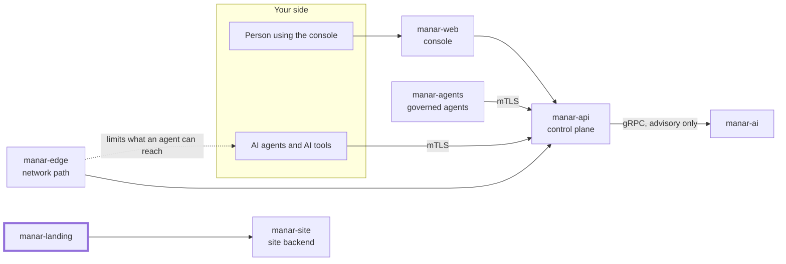

# manar-landing

The public Manar website: a bilingual (English and Arabic) Next.js site with a demo request and meeting booking flow.

## Where it fits in Manar

Manar is a control plane that governs AI agents and AI tools: who an agent is, what it may do,
who approves risky actions, and a tamper-evident record of what happened. This repository is the
thick-bordered box of the picture below; the other parts live in their own repositories under
[github.com/manarhq](https://github.com/manarhq).



Bilingual (English / Arabic) marketing homepage and demo request flow for Manar (منار), a VAX product.
Next.js 16 (App Router, Turbopack), React 19, TypeScript, Tailwind CSS v4, shadcn/ui on Base UI.

This repository contains only the public website. The governance application lives in `manar-web`.

## Run locally

```bash
npm install
cp .env.example .env.local   # fill in values as needed; never commit .env files
npm run dev                  # http://localhost:3000 → redirects to /en
```

| Command             | Purpose                                                            |
| ------------------- | ------------------------------------------------------------------ |
| `npm run dev`       | Development server                                                 |
| `npm run build`     | Production build                                                   |
| `npm start`         | Serve the production build (requires the Node.js server)           |
| `npm run lint`      | ESLint (flat config, `eslint-config-next`)                         |
| `npm run typecheck` | Generate route types, then `tsc --noEmit`                          |
| `npm test`          | Unit tests for demo-request validation, email, and transport (Node's built-in test runner, no network) |

## Routes

| Route                | Description                                            |
| -------------------- | ------------------------------------------------------ |
| `/`                  | Permanently redirects (308) to `/en`                   |
| `/en`, `/ar`         | Homepage (statically prerendered)                      |
| `/en/meet`, `/ar/meet` | Book a meeting: pick a person or "Any of us", a time, then details (`Book a meeting` CTA) |
| `/en/meet/confirm`, `/en/meet/manage` (and `/ar/...`) | Emailed links: confirm, reschedule or cancel a booking (noindex) |
| `/en/demo`, `/ar/demo` | Written request form, the fallback when online booking is unavailable |
| `/sitemap.xml`       | Public XML sitemap for the four canonical pages and their language alternates |
| `/robots.txt`        | Public crawler rules and absolute sitemap location    |
| `POST /api/demo-request` | Validates a demo request and emails it (Node.js runtime) |
| `/api/meet/*` | Same-origin proxy to manar-site `/public/meet/*` (allowlisted routes only) |
| `POST /api/revalidate` | Refreshes published content; `Authorization: Bearer $REVALIDATE_SECRET` |
| `/media/<uuid>.<ext>` | Images uploaded in the admin, forwarded from manar-site `/public/media/*` (png, jpg, webp, avif only) |
| `/<locale>[/page]?preview=<token>` | Admin draft preview: redirects to `/api/preview`, which checks the token with manar-site, turns on draft mode for that browser and keeps the token in an httpOnly cookie. Draft pages are rendered per request, never cached, sent with `X-Robots-Tag: noindex` and show a Preview bar. `/api/preview/exit` leaves |

Unsupported locales return 404 (`dynamicParams = false`).

## Environment variables

| Variable          | Required for          | Notes |
| ----------------- | --------------------- | ----- |
| `SITE_URL`        | Sitemap/robots/metadata | Public origin; defaults to `https://manar.fixio.ae`. Read at **build time**. Overrides must be absolute HTTP(S) origins with no credentials, path, query, or fragment. Invalid values fail the build. Docker requires an explicit build argument; CI already supplies it. |
| `NEXT_PUBLIC_CONSOLE_URL` | Console links, legal text | Defaults to `https://console-manar.fixio.ae`. **Build time** (Docker `ARG`). |
| `NEXT_PUBLIC_STATUS_URL` | Status link | Defaults to `https://status-manar.fixio.ae`. **Build time** (Docker `ARG`). |
| `ACS_EMAIL_ENDPOINT` | Sending demo requests | The Azure Communication Services resource endpoint, `https://<resource>[.<geo>].communication.azure.com`. Anything else is refused. |
| `ACS_EMAIL_TENANT_ID` | Sending demo requests | Entra tenant of the sending app. |
| `ACS_EMAIL_CLIENT_ID`, `ACS_EMAIL_CLIENT_SECRET` | Sending demo requests | Server-only. The landing's own Entra app, holding only a send role on the ACS resource; the resource's access key is never used. |
| `DEMO_FROM_EMAIL` | Sending demo requests | A sender address of the ACS Email domain linked to that resource, e.g. `noreply@your-domain` (the display name is set on the sender in Azure). |
| `NEXT_PUBLIC_POSTHOG_KEY` | Optional analytics | PostHog EU project key (cookieless, public by design), read at **build time** (Docker build argument, passed by CI from the masked variable of the same name). Enables the consent banner; the beacon loads only after opt-in. Unset: no banner, no beacon. |
| `NEXT_PUBLIC_TURNSTILE_SITE_KEY` | Booking | Cloudflare Turnstile site key, **build time** (CI build argument from the variable of the same name). |
| `SITE_API_URL` | Content and booking | manar-site origin, **runtime**, server only. Unset or unreachable: bundled content, and `/meet` offers the request form. |
| `REVALIDATE_SECRET` | Content publishing | At least 32 characters, **runtime**, server only. Unset: `/api/revalidate` returns 404. |

### Turning on analytics (PostHog EU analytics)

1. Cloudflare dashboard: **Analytics and Logs → Web Analytics → Add a site**, hostname `manar.fixio.ae`, and
   choose the JavaScript snippet (not automatic setup, which injects the beacon without consent).
   Copy only the `token` value from the snippet.
2. GitLab `manar/landing`: **Settings → CI/CD → Variables → Add variable**, key `NEXT_PUBLIC_POSTHOG_KEY`,
   the token as value, **Masked** and **Protected** on (protected so only `main` builds see it).
3. The next merge to `main` builds it in. Check: the banner appears on a first visit; nothing loads from
   `static.cloudflareinsights.com` until **Accept analytics**; with Global Privacy Control on, no banner.

## Search indexing

Next.js generates `/robots.txt` and `/sitemap.xml` as public, static metadata routes at the domain root;
they require no login, cookies, or locale prefix. The sitemap contains `/en`, `/ar`, `/meet`, `/demo` and
the legal pages in both languages, with reciprocal English/Arabic alternates and an English `x-default`. It excludes the root
redirect and operational endpoints. `lastmod` is omitted because content modification dates are not
tracked; do not substitute build time for the date of a real content update.

Robots rules allow public pages and rendering assets, and disallow crawling `/api/` and `/_edge-health`.
These rules are crawler hints, not access controls or a guarantee that an endpoint cannot be indexed.
Every public page has a self-referencing canonical, localized title/description, language alternates,
and `index, follow` metadata. Both homepages include consistent `WebSite`, `Organization` and
`SoftwareApplication` structured data (no FAQPage: the page shows no FAQ). The booking confirm and manage
pages are `noindex`. No keyword stuffing, invented reviews, or ratings are needed.

After deploying:

1. Open `https://manar.fixio.ae/robots.txt` and `https://manar.fixio.ae/sitemap.xml` without signing in.
   Both must return HTTP 200 with plain-text/XML content, not a challenge or HTML error page. If
   Cloudflare still serves an earlier cached 404, purge those two URLs and check again. Keep Googlebot
   able to access pages, CSS, JavaScript, and images through any Cloudflare bot/access rules.
2. Verify the `manar.fixio.ae` property in [Google Search Console](https://search.google.com/search-console)
   (DNS verification works without application changes), and submit `https://manar.fixio.ae/sitemap.xml`
   in **Sitemaps**.
3. Use **URL Inspection → Test live URL** on `/en` and `/ar`, then **Request indexing**. Follow the
   Page indexing report for exclusions and the Performance report for actual search queries.

CI's optional public smoke check (`PRODUCTION_SMOKE_URL=https://manar.fixio.ae`) validates both discovery
files after release. Google decides whether and when to index and rank a page; a valid sitemap does
not guarantee either. Reference: [Google sitemap guidance](https://developers.google.com/search/docs/crawling-indexing/sitemaps/build-sitemap),
[localized pages](https://developers.google.com/search/docs/specialty/international/localized-versions),
and [technical requirements](https://developers.google.com/search/docs/essentials/technical).

## Demo request email

- Flow: `components/demo/demo-form.tsx` → `POST /api/demo-request` (`app/api/demo-request/route.ts`)
  → `handleDemoRequest` (`lib/demo/handle-request.ts`) → transport (`lib/demo/server.ts`).
- The recipient is fixed server-side: `info@fixio.ae` (`DEMO_REQUEST_RECIPIENT`). No request field can change it.
  The visitor's validated email is used as `Reply-To`.
- Validation runs in the browser and again on the server (`lib/demo/validation.ts`): required fields, email
  syntax (personal providers are accepted), length limits, allowed deployment options, and rejection of line
  breaks in single-line fields (header injection). Request bodies over 16 KB and non-JSON bodies are rejected.
- The email has HTML (all values escaped) and plain-text parts, and includes locale and UTC submission time.
- Spam and abuse: a hidden honeypot field (silently accepted, nothing sent) and a rate limit of 5 requests per
  client per 10 minutes.
- Failure behaviour: missing configuration (503), provider rejection or network failure (502) all show a
  localized failure with `info@fixio.ae` as an alternative. The visitor's input is preserved. Only the failure
  reason is logged (`demo_request_email_failed`), never submission content.
- A 200 response means the provider **accepted** the message. It is not proof of inbox delivery.
- Delivery is Azure Communication Services Email (UAE), over its REST API with an Entra client-credentials
  token for the landing's own app (`lib/demo/acs.ts`, no SDK). To change provider, replace `createAcsTransport` in `lib/demo/server.ts` with another
  function matching `EmailTransport`. The handler and UI do not depend on the provider.

### Rate limiting limitation

`lib/demo/rate-limit.ts` is in-memory and per process. It is effective for a single Node instance. With several
replicas or serverless instances, each keeps separate counters that reset on restart. For replicated deployments,
add a shared store (for example Redis) or edge/WAF rate limiting in front of `/api/demo-request`.
The client key comes from `x-forwarded-for` / `x-real-ip`; only trust these behind a proxy that sets them.

### Email setup

1. An Azure Communication Services resource with an Email domain linked (verified domain, sender address).
2. An Entra app for the landing with only a send role on that resource (a custom role with
   `Microsoft.Communication/CommunicationServices/Read` and `/Write`; never one with `ListKeys`).
   Set `ACS_EMAIL_ENDPOINT`, `ACS_EMAIL_TENANT_ID`, `ACS_EMAIL_CLIENT_ID`, `ACS_EMAIL_CLIENT_SECRET` (secret) and
   `DEMO_FROM_EMAIL` in the deployment environment.
3. Submit one real request from the deployed site and confirm it arrives at `info@fixio.ae`.

## Deployment requirements

The site needs a Node.js server runtime because the demo endpoint runs server-side. Do not configure
`output: "export"`; a static export removes the endpoint. Production runs as a container on K3s behind Traefik,
an edge Nginx, and Cloudflare: see [`deploy/README.md`](deploy/README.md) and the `Dockerfile`.
`/api/health` serves liveness and readiness probes. `TRUSTED_CLIENT_IP_HEADER` names a proxy-set header to use as
the client IP for rate limiting; set it only when every request passes a proxy that overwrites that header.

## Editing content and translations

- Every visible string, link and image is in the content model, `lib/content/`: one typed document per
  locale (`en.ts`, `ar.ts`, plus the legal documents in `legal/`), composed in `index.ts` and validated by
  the zod schema in `schema.ts`. manar-site seeds its CMS from these documents and serves the published one at
  `GET /public/content/:locale` as `{ version, content }`.
- Pages render from `getContent(locale)` (`lib/content/load.ts`): the published document, cached for 60 s
  under the `site-content` tag, or the bundled one when `SITE_API_URL` is unset, the API is unreachable, or
  the answer fails validation.
- The schema rejects en and em dashes, banned words, markup, off-site booking links, external links outside
  `EXTERNAL_HOSTS`, and images that are not raster files under `/public`. `npm test` validates both documents.
- Locales and direction: `lib/i18n/config.ts`. The `[lang]` root layout sets `lang` and `dir` on the server.
- Use logical Tailwind utilities (`ms-*`, `pe-*`, `start-*`, `text-start`) so layouts mirror in RTL. Mirror
  directional arrows with `rtl:-scale-x-100`. Never mirror the logo. Wrap emails, IDs, and URLs in
  `ltr-fragment` (or `<bdi>`).
- Example data (the hero approval record) stays labelled as an example. Do not add customer names,
  certifications, performance numbers, or integrations that have not been confirmed.

## Brand tokens and theme

- Design system: `docs/design/DESIGN-SYSTEM.md` in the workspace repo (Midnight). Tokens live once in
  `app/globals.css` with the same names and values as manar-web: light on `:root`, dark on `.dark`. shadcn's
  slots (`--primary`, `--muted`, ...) map onto them; the landing's primary is the brand red.
- One radius: 6px (4px for badges). Spacing steps 4, 8, 12, 16, 24, 32, 48, 64, 96 only.
- Fonts: Readex Pro (Arabic and Latin) and JetBrains Mono self-hosted (`app/fonts.css`).
- Theme: follows the system by default; an explicit choice is stored in `localStorage` (`manar-theme`) and
  applied by an inline script before first paint (`app/[lang]/layout.tsx`).
- Motion: colour transitions only, plus one hero animation (the example request moving to approved). No
  scroll animation. Everything is off under `prefers-reduced-motion`.

## Brand assets

- `public/brand/manar-lighthouse.png`: the selected lighthouse mark (Stitch Concept B, 160 × 168 RGBA).
  Always render it at its natural aspect ratio next to live "Manar" / "منار" text.
- `app/favicon.ico`, `app/icon.png`, `app/apple-icon.png`: derived from that PNG by padding to a square
  (no redrawing).
- `public/og/manar-en.png`, `public/og/manar-ar.png`: 1200 × 630 social images (Stone dark, the mark, the
  headline), rendered from HTML with Playwright.
- `public/photo/lighthouse-day.webp` (light theme) and `public/photo/lighthouse-night.webp` (dark theme): the
  "where it runs" photograph, same framing and aspect ratio, swapped by the `.dark` class. AI-generated for this
  site with Figma image generation; no third-party licence applies. Replace with commissioned photography when
  available. The site does not use next/image; the photos are served as shipped (webp).
- `public/fonts/`: Readex Pro (variable; Arabic, Latin and Latin Extended subsets) and JetBrains Mono (Latin 400),
  self-hosted under the SIL Open Font License 1.1 (`OFL-readex-pro.txt`, `OFL-jetbrains-mono.txt`). File names end
  in the first 8 hex of the file's sha256 (`readex-pro-latin-wght-normal.7074eeb9.woff2`) so nginx can cache them
  as immutable; when a font changes, rename it and update `app/fonts.css` and `lib/fonts.ts` (a test checks the
  hash). Faces and fallback metrics are in `app/fonts.css`; each locale preloads only its own files
  (`lib/fonts.ts`).
- `design/stitch/`: exported Stitch references (design input only, not site source; the copy in those files
  contains unverified claims and must not be reused as-is).

## Licence and links

Licensed under the [Apache License 2.0](LICENSE). Copyright 2026 Fixio; see [NOTICE](NOTICE).
Contributions need a DCO sign-off: [CONTRIBUTING.md](CONTRIBUTING.md). Report vulnerabilities
privately: [SECURITY.md](SECURITY.md). The Manar name and logo are trademarks of Fixio:
[TRADEMARK.md](TRADEMARK.md). Everyone taking part follows the [Code of Conduct](CODE_OF_CONDUCT.md).

Product site: <https://manar.fixio.ae>
